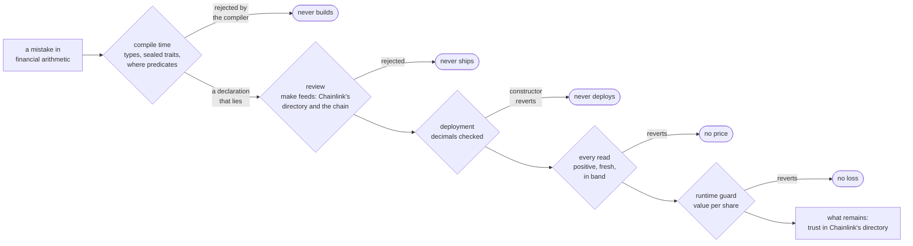

<div align="center">

# Dimension

**Fe types that know which way value moves.**

[For judges](JUDGES.md) · [Documentation](docs/README.md) · [The library](ingots/dimension) · [Results](docs/results) · [The site](web)

[](https://github.com/Femtech-web/Dimension/actions/workflows/ci.yml)
[](https://github.com/Femtech-web/Dimension/releases/tag/v0.1.0)
[](https://github.com/argotorg/fe/releases)
[](#license)

</div>

**Dimension is a Fe library in which the arithmetic behind two of DeFi's
costliest recent failures does not compile. Every claim it makes is checked
against the original code and the real chains.**

> *"This is the only place where we round in the same direction for all
> amounts, as the impact of this rounding is expected to be minimal."*
> — Balancer V2, [`_upscale`](third_party/balancer-v2/pkg/solidity-utils/contracts/helpers/ScalingHelpers.sol)

In November 2025 that rounding drained Balancer V2's composable stable pools,
for an estimated 95 to 128 million USD. In February 2026, a Moonwell
governance proposal priced cbETH with its ETH exchange rate instead of a USD
price, and for eight days the market valued it at 1.12 USD. Both mistakes were
visible in review: one in a comment, the other in a feed's name,
`cbETHETH_ORACLE`. Neither could be enforced, because to the compiler every
number was a `u256`.

Dimension puts that meaning into Fe's types:

- an amount knows its token and which way it moves, and its rounding follows;
- a price knows its pair, and composes only through a shared asset;
- an external number becomes trusted only at a boundary that checks it.

What types cannot see, a runtime guard catches. Both incidents are reproduced
on their real code and chain state, and both are stopped.

## Contents

- **The work:** [Two incidents, replayed](#two-incidents-replayed):
  [Balancer V2](#balancer-v2-balancers-own-line-rejected-by-the-compiler),
  [Moonwell](#moonwell-mip-x43-112-usd-and-220668-usd-from-the-same-feeds),
  [an ERC-4626 vault](#beyond-the-incidents-an-erc-4626-vault) ·
  [How it works](#how-it-works) · [Fe highlight](#fe-highlight)
- **The evidence:** [See it in one minute](#see-it-in-one-minute) ·
  [Checked and attacked](#checked-and-attacked) · [Try to break it](#try-to-break-it) ·
  [How it compares](#how-it-compares) · [Limits](#limits)
- **Using it:** [Use it in your protocol](#use-it-in-your-protocol) ·
  [Build and test](#build-and-test) · [Repository layout](#repository-layout)
- **About:** [Found along the way](#found-along-the-way) · [Declaration](#declaration) ·
  [License](#license)

## Two incidents, replayed

### Balancer V2: Balancer's own line, rejected by the compiler

**First, the port is Balancer.** Balancer's math, pool paths and protocol fees
were ported to Fe line by line, then checked three ways:

- **Against Balancer's own Solidity:** 220,000 vectors, 0 mismatches, reverts
  included.
- **Against the deployed osETH/wETH pool:** its real state, forked at block
  23,717,396, the last block before the attack. 669 quotes, 0 mismatches.
- **Against the attack itself:** the attacker's three transactions, 360 swaps,
  replayed step by step from the real chain state. Every amount the Fe port
  computes equals what Balancer's Vault computed. After each transaction the Fe
  pool holds exactly what the real pool held, all the way down from 4,922 WETH
  to 0.14. Getting there meant porting Balancer's protocol fees too: the pool
  minted fee shares 33 times inside the first transaction alone. With the fee
  logic removed, only 94 of its 121 steps match.

**Then, the bug is real in it.** Over 4,608 pool states, 57,990 exact-out
exits lower the value behind each pool share (worst 14.86%). A greedy attacker
takes 20.9 invariant units from a 1,000-wei pool. Deployed on an EVM, the same
attack cuts the value per share by 3.38%.

**With Dimension, the line does not compile.** The typed pool reaches
StableMath only through signatures that demand admitted amounts. Putting
Balancer's line back is a type error:

```
$ make show CASE=typed_pool_with_balancer_upscale
  the bug:   rejected by the compiler, error[8-0000]: type mismatch
             expected `Quantity<_, Out, Admitted>`, but `u256` is given
  the fix:   -    let scaled_out = upscale(amount_out.value(), factor.value())
             +    let scaled_out = admit(amount_out, factor)
  fixed:     compiles; PASS charges_what_the_typed_pool_charges_and_more_than_balancer
```

| Same states, same attacks | Balancer (faithful port) | Typed | Typed + guard |
|---|---|---|---|
| **The attacker's own 360 steps, from the real state** | **complete: value per share 1.027 → 0.0000092** | revert at step 25 | revert at step 25 |
| An attacker who re-plans 90 swaps from the real dust state | **value per share −43.9%** | never below its start | never below its start |
| Exact-out exits that lower value per share | 57,990 | 8 | **0** |
| Exact-out swaps that lower value per share | 48 | **0** | **0** |
| Greedy attacker on a 1,000-wei pool, invariant units | **+20.923** | −151.416 | −151.416 |
| Value per share after the attack, on an EVM | **−3.38%** | +19.51% | +19.51% |
| Gas per exact-out exit | 24,493 | 25,338 (+3.4%) | 26,154 (+6.8%) |

On the typed kernels, the same steps charge the attacker more once the balances
reach dust: 17 wei of osETH out costs 1,071,109 wei of WETH instead of 625,492.
The pool drifts from the state the attacker planned against, and step 25 fails
Balancer's own `BAL#001` check, which reverts the whole batch. Up to that step
the value per share had risen from 1.027 to 1.186: the attack was paying the
pool. The replay shows that the attacker's own sequence cannot run, so it then
starts an attacker from the same dust state that re-plans every swap, picking
from about 95 amounts in both directions the one that leaves the value per
share lowest. On Balancer's arithmetic it cuts that value by 43.9% in 90 swaps.
On the typed kernels it never gets below where it started, and ends 13.1%
above. In the search, the types remove the losses at Balancer's two rounding sites;
the 8 that remain come from StableMath's own precision, and the guard rejects
exactly those. [The full account →](docs/balancer.md)

### Moonwell MIP-X43: 1.12 USD and 2,206.68 USD, from the same feeds

Dimension's oracle, deployed on Base forks, reads the two Chainlink feeds that
Moonwell's composite oracle combined: cbETH/ETH and ETH/USD. It multiplies
them, because the types allow nothing else:

| Base block | | Moonwell's oracle | Dimension |
|---|---|---|---|
| 42,194,662 | the last block before MIP-X43 | 2,206.68 USD | 2,206.68 USD, **identical to the wei** |
| 42,194,663 | MIP-X43 executes, 2026-02-15 18:04:33 UTC | **1.12 USD** | 2,206.68 USD |
| 11 more blocks over the next 8 days | | 1.12 USD | 2,091 to 2,243 USD |
| 42,538,949 | the fix executes, 2026-02-23 17:20:45 UTC | 2,091.16 USD | 2,091.16 USD, **identical to the wei** |

The mistake is stopped wherever it is made:

| The mistake, made as | Stopped at | By |
|---|---|---|
| MIP-X43 wrote it: the cbETH/ETH feed as cbETH's USD price | **compile time** | `expected Feed<CBETH, USD>, but Feed<CBETH, ETH> is given` |
| A registry entry that lies, with a USD feed's 8 decimals | **deployment** | the constructor checks the real feed: `WrongDecimals(feed, 8, 18)` |
| A registry entry that lies, with the real 18 decimals | **the first read** | 1.12 is outside the band declared for a USD price: `AnswerOutOfBand` |
| Any registry entry that lies, even one every on-chain check accepts | **review**, before deployment | `make feeds`: Chainlink lists `0x806b…440b` as CBETH / ETH, and its CBETH / USD feed at `0xd781…817d` |

[The on-chain record, block by block →](docs/moonwell.md)

### Beyond the incidents: an ERC-4626 vault

A vault's share accounting is where rounding directions are most often chosen
by hand. EIP-4626 fixes four of them, and OpenZeppelin names one in each
function. The vault written with Dimension names none. Each operation states
which way its given amount moves, and `exchange` rounds what the vault gives
back by the opposite direction:

```fe
/// Shares for depositing `assets`: assets come in, shares go out.
pub fn preview_deposit<A>(_ v: Vault<A>, _ assets: Quantity<A, In, Given>) -> Quantity<
    Shares<A>,
    Out,
    Settled,
> {
    exchange(
        assets,
        numerator: v.total_shares + 1,
        denominator: v.total_assets + 1,
    )
}
```

All four roundings match OpenZeppelin's ERC4626 v5.1.0 on 40,000 vectors in
the same states. In 33,684 of them the exact result is fractional, so the
direction decided the answer. They are also exact against the rational result
on every small vault state, on both backends.
[The vault →](docs/vault.md)

## See it in one minute

```sh
make toolchain   # Fe 26.6.0, downloaded and checksum-verified
make demo        # both incidents: the mistake, the compiler's verdict, the fix, the evidence
```

Then `make ci` runs every offline check in about a minute, and `make replay`,
`make fidelity` and `make moonwell` run the fork comparisons. [JUDGES.md](JUDGES.md) is a
ten-minute tour with ways to try to break it, and the site in [`web/`](web)
(`make web`) shows every saved result: the replay and the Moonwell prices
charted, every claim, every planted bug.

## How it works

Four layers. Each one catches what the one before cannot:



1. **Financial types.**
   - `Quantity<T, F, S>` is an amount of token `T`, moving `In` or `Out` of
     the protocol, at stage `Given`, `Admitted`, `Owed` or `Settled`. Only
     `admit` and `settle` reach the trusted stages, and they take their
     rounding from the direction. A call site never names a rounding.
   - `Price<B, Q>` composes only through a shared asset.
   - `Value<Q, V>` rounds collateral down and debt up, and the two cannot be
     added.
   - Risk policies are checked by `where` predicates. A liquidation bonus that
     would create bad debt fails to compile.
2. **Verified boundaries.** Each feed is declared once, as a typed constant
   with its pair, decimals, maximum age and band. Its decimals are checked when
   a contract binds it, and every read checks the answer is positive, fresh
   and in band.
3. **A runtime guard.** An exact 512-bit check rejects any operation that
   lowers the value behind a pool share, whatever its cause.
4. **Independent verification.** Ports are compared with the original code and
   with deployed contracts on forks. An exhaustive search runs the same kernels
   natively, and every rejected construction has a corrected twin that must
   pass.

What each layer guarantees, and what it does not:
[docs/guarantees.md](docs/guarantees.md).

## Fe highlight

**Rounding derived from meaning, enforced by the compiler, at zero runtime
cost.** A direction is a sealed trait whose associated types name its
roundings, and `admit` is the only producer of an admitted amount:

```fe
pub trait Flow: Sealed {
    /// Rounding for bringing a given amount into internal accounting.
    type Admission: Rounding
    /// Rounding for turning an internal result into an amount to transfer.
    type Obligation: Rounding
}

/// Value the protocol pays out: count at least what leaves, pay no more than owed.
impl Flow for Out {
    type Admission = Ceil
    type Obligation = Floor
}

pub fn admit<T, F: Flow>(_ q: Quantity<T, F, Given>, _ factor: ScalingFactor<T>) -> Quantity<
    T,
    F,
    Admitted,
> {
    Quantity { v: F::Admission::mul_div(q.v, factor.v, WAD) }
}
```

The direction is resolved statically. The typed code compiles to the same
bytes as hand-written `mul_div_ceil` at `-O1`, `-O2` and `-Os`, with identical
hashes recorded by the probes. On the library itself (`make evm`), Dimension's
four roundings compile to the same bytes as the hand-written `mul_div` calls,
and an ERC-4626 vault built on it to the same size and the same gas on every
call. Both return exactly what the hand-written code returns, on 4,096 calls at
every optimization level.

The rest of Dimension leans on Fe throughout:

| Fe feature | What Dimension does with it |
|---|---|
| Phantom generics, module-scoped privacy | Trusted values have private fields; only their checking functions construct them |
| Sealed traits with associated types | Exactly two roundings, two flows and two valuation sides; none can be added |
| A recursive associated type (`type Opposite: Flow`) | An exchange's result moves opposite to what it received, so an ERC-4626 vault's four roundings need no code |
| `where` predicates on associated constants | Incoherent risk policies and assets over 18 decimals fail to compile |
| Const generics with bounds | One StableMath for 2 to 5 tokens (`const N: usize where N >= 2, N <= 5`) |
| Effects | A feed read needs `uses (call: mut Call, ctx: Ctx)`. Failure is an effect too: one kernel reverts with Balancer's `BAL#` codes on the EVM and records failures in a native search |
| `const fn`, `#[error]` | Feed registries are typed constants; boundary failures are typed reverts |
| The `allow_unsafe` gate | Test constructors exist, and deployable code cannot reach them (`make unsafe-policy`) |
| One source, two backends | The same kernels run as EVM contracts and as a native search, pinned to identical integers |

## Checked and attacked

| Check | Scale | Result | Run |
|---|---|---|---|
| Fe StableMath against Balancer's Solidity, on identical calldata | 22 functions, 220,000 vectors | 0 mismatches; 49,100 identical reverts | `make differential` |
| The Fe pool against the deployed pool, on a mainnet fork | 446 swaps, 223 exact-out exits | 0 mismatches | `make fidelity` |
| The attacker's own transactions, step by step, from the real state | 3 transactions, 360 swaps | every amount equal; every end state equal | `make replay` |
| Exhaustive search, three kernels, exact integers | 4,608 pool states, about 3.14M operations each | the two invariants hold under the guard in every operation kind | `make explore` |
| The same kernels on the EVM and natively | pinned grid and attack | identical integers | `make unit` |
| The pool contracts at every optimization level | `-O0`, `-O1`, `-O2`, `-Os` | the same attack to the wei at each; gas and size per level | `make evm` |
| Typed code on Dimension against the same code by hand on raw `u256` | 2 pairs, 8 functions, 4,096 calls per level, 4 levels | identical results at every level; above `-O0`, identical gas, and identical bytes for the roundings | `make evm` |
| Admission and settlement against the exact rational result | 20,000 per backend | exact floor and ceil | `make unit` |
| Constructions the compiler must reject | 17 cases, each with a corrected twin | all rejected with the intended error; all twins pass | `make compile-fail` |
| Language behaviour the design rests on | 20 probes with golden outputs and bytecode hashes | all as recorded, identical on macOS and Linux | `make probes` |
| Moonwell's market on Base forks | 14 blocks across the incident | Dimension correct at every block; identical to Moonwell where Moonwell was right | `make moonwell` |
| Each declared feed against Chainlink's directory and Base | the registry, plus 2 wrong declarations that compile | the registry passes 10 of 10 checks per feed; both wrong ones rejected, one that passes every on-chain check | `make feeds` |
| The ERC-4626 vault against OpenZeppelin's ERC4626 | 40,000 vectors, 33,684 where the rounding decides | all equal | `make vault` |
| The vault against the exact rational result | 32,768 states × 4 previews, both backends | exact floor or ceil as EIP-4626 requires | `make unit` |
| Planted bugs in the safety-critical code | 17 mutants across 7 layers | every one caught, for the reason expected of it | `make mutants FORKS=1` |
| A fresh project from `dimension new`, taking Dimension by git | the quickstart, a misuse, two unsafe setups | builds and passes its tests; the misuse is rejected; `dimension check` passes it and fails both setups | `make consumer` |

Every run writes a report to [`docs/results/`](docs/results). Each claim in it
is a question, an answer and its evidence, and a claim that fails fails the
run.

## Try to break it

`make mutants` plants realistic bugs, one at a time, in a scratch copy, and runs
the check meant to catch each. A mutant counts as caught only if that check
fails for the reason expected of it. A failure for any other reason, such as a
network error, is reported as inconclusive and fails the run. `FORKS=1` adds
the two that need a fork. **All 17 are caught:**

| Bug planted | Caught by |
|---|---|
| Balancer's `_upscale` put back into the typed pool | the compiler: `expected Quantity<_, Out, Admitted>` |
| An outflow admitted rounding down; a charge settled rounding down | unit tests against the exact rational result |
| An exchange that gives back value moving the same way | the compiler: the vault no longer type-checks |
| A feed's band, age or decimals unchecked; a rate's band unchecked | the oracle boundary tests |
| The guard always passing, or switched off on exits | the search: losses reappear |
| A risk policy's bad-debt predicate dropped | the compile-fail suite: the bad policy compiles |
| The port's `+ 1` dropped, or its `mulUp` rounding down | the differential test against Balancer's Solidity |
| An extra virtual share in the vault | the comparison with OpenZeppelin |
| `unsafe` in a protocol ingot | the unsafe policy |
| Protocol fees skipped on joins and exits | the replay: 94 of 121 steps match instead of 121 |
| ETH/USD declared with 18 decimals | the Moonwell fork: the oracle no longer deploys |

One more experiment shows the layers are independent. Make `Out` admit with
`Floor`, and the typed kernel loses exactly as Balancer did (57,990 exits),
yet the guard still rejects every one of those losses.

## How it compares

| Prior work | What it does | What Dimension adds |
|---|---|---|
| [fe-fixedpoint](https://github.com/ridakalam52-design/fe-fixedpoint) | exact fixed-point math for Fe, with a runtime rounding mode | the rounding is decided by the type, and a wrong one does not compile |
| Balancer V3 `ScalingHelpers` | `...RoundDown` and `...RoundUp` variants, picked by the caller | the call site does not pick |
| [roundme](https://github.com/crytic/roundme), [ScType](https://conf.researchr.org/details/icse-2024/icse-2024-research-track/127/Towards-Finding-Accounting-Errors-in-Smart-Contracts) | advise on, or detect, rounding and accounting errors in Solidity | prevention at compile time, plus checked boundaries and a runtime guard |
| [Remix workshop](https://github.com/remix-project-org/remix-workshops/tree/master/RoundingDirectionExploit), [Quint model](https://github.com/informalsystems/quint-balancer-v2-rounding-bug) | teach, or model, the Balancer bug on a simplified pool | the real kernel, verified against Balancer and the deployed pool, then made unable to express the bug |

[The full comparison →](docs/comparison.md)

## Use it in your protocol

Dimension is for engineers writing DeFi contracts in Fe. It is a Fe library
ingot: your contracts depend on it, and its checks run when they compile. Take
it from this repository, pinned to a commit:

```toml
[dependencies.dimension]
source = "https://github.com/Femtech-web/Dimension"
rev = "57ce4106575a173b9fc51ebb44c3c2243e285cd5"   # v0.1.0
name = "dimension"
version = "0.1.0"
```

Fe resolves `rev` as a full commit hash, so each release's commit is listed in
the [changelog](CHANGELOG.md). Then start from
[`examples/quickstart`](examples/quickstart), a deposit desk contract with its
tests, and follow [docs/guide.md](docs/guide.md):

- getting started in five steps;
- every concept, with code from the tests;
- the method used to port Balancer;
- a checklist before production.

The command line, [`cli/dimension.py`](cli/dimension.py), starts a project
and checks it before deploying. It needs only Python's standard library; run it
from a clone of this repository:

```sh
python3 cli/dimension.py new ../my-protocol                     # the quickstart, pinned to the latest release
(cd ../my-protocol && fe test)
python3 cli/dimension.py check ../my-protocol --network base    # the checklist before deploying
```

`check` fails a project that could forge or misprice what Dimension trusts:
`allow_unsafe` set on Dimension, any `unsafe` code, code that does not compile,
or a Chainlink feed that is not the feed it is declared to be, checked against
Chainlink's directory and the chain by [`feed_check.py`](cli/feed_check.py). It
warns on a dependency not pinned to a release, and on an untested Fe version.

The library's own page is [`ingots/dimension`](ingots/dimension), and its
security policy is [SECURITY.md](SECURITY.md). `make consumer` checks this path
on every CI run. `dimension new` creates the project, taking Dimension by git;
its 3 tests must pass, and a misuse must be rejected. `dimension check` must
pass it, and fail it once `allow_unsafe` or `unsafe` code is added.

## Limits

- **The Balancer kernel models one pool, not the protocol:** two tokens, with
  protocol fees, but no amplification ramp or rate change between joins and
  exits. The replay runs the attack's steps on this pool, not the other pools
  in the same batches.
- **Types cannot prove an address is the feed it is declared to be.** A wrong
  feed that reports the declared decimals, with answers inside the declared
  band, passes every on-chain check. `make feeds` catches it before
  deployment by checking each declaration against Chainlink's directory and
  the chain. That covers Chainlink feeds only: a rate provider (`RateSource`)
  or another oracle network has no directory to check against, and stays a
  reviewed declaration. The trust moves to Chainlink's own record, at review
  time; nothing enforces it on chain.
- **The guard costs gas:** about +48% on swaps and +6% to +8% on joins and
  exits at the default `-O1`, within two points of that at `-O2` and `-Os`,
  so it is opt-in. On swaps that is one more invariant solve, which
  cannot safely be shortened: started from the invariant before the
  operation, Newton's integer iteration settles on a different value at dust
  balances, and in the search that let 13 losing operations through. The
  typed contract costs 800 to 1,000 gas more per operation (+3% to +6%), for
  its checked rate read.
- **Rounding up refuses some dust:** 1 wei out of a 2-wei balance, which
  Balancer paid out for free.
- **No attack found is not no attack possible.** The replay proves the
  recorded attack cannot run. That no other sequence pays rests on evidence,
  not proof: an attacker re-planning 90 swaps from the real dust state, and
  every single operation over 4,608 small pools.

All of them, with their evidence: [docs/guarantees.md](docs/guarantees.md).

## Build and test

Requires `make`, `curl`, Python 3.12 and [Foundry](https://getfoundry.sh)
1.4.4. The compiler is pinned to Fe 26.6.0
(`5b3f96af2ab10df11bf847551f4b81d1fe481110`) and checksum-verified into
`.tools/`; nothing uses a globally installed `fe`. Every ingot also
type-checks, and every test suite passes, on Fe 26.7.0. The manifest is
[`fe.toml`](fe.toml), a workspace of the ingots in [`ingots/`](ingots).

| Command | What it does |
|---|---|
| `make ci` | Formatting, unsafe policy, unit, compile-fail, probes, differential, search, EVM, vault, consumer: what CI runs |
| `make demo` | Both incidents, live |
| `make fidelity` | The Balancer port against the deployed pool (mainnet fork; `MAINNET_RPC_URL` overrides the public RPC) |
| `make replay` | The attacker's three transactions, step by step, through the three kernels (mainnet forks) |
| `make moonwell` | Moonwell's market around MIP-X43 (Base forks; `BASE_RPC_URL` overrides the public RPC) |
| `make feeds` | Each declared feed against Chainlink's directory and Base; wrong declarations must be rejected |
| `make vault` | The ERC-4626 vault against OpenZeppelin's ERC4626 |
| `make mutants` | Plants realistic bugs one at a time; each must be caught by the check meant for it |
| `make consumer` | Builds the quickstart as a fresh project taking Dimension by git |
| `make apidoc` | Generates the API reference from the library's doc comments |
| `make web` | Syncs the saved reports into [`web/`](web) and builds the site |
| `make help` | Every target |

CI runs `make ci` on Linux, and the fork comparisons in a separate job.
Native executables exist for `linux_amd64` and `mac_arm64` in Fe 26.6.0;
elsewhere the native search is skipped.

## Repository layout

| Path | Contents |
|---|---|
| [`ingots/dimension`](ingots/dimension) | The library: assets, flows, roundings, prices, values, policies, the guard, the oracle boundary |
| [`examples/quickstart`](examples/quickstart) | A deposit desk contract and its tests: the project a team starts from |
| [`cli`](cli) | The command line for teams using Dimension: `new`, `check`, `feeds` |
| [`ingots/balancer_v2`](ingots/balancer_v2) | Balancer V2 ported: StableMath, the faithful, typed and guarded pools, their contracts |
| [`ingots/balancer_explorer`](ingots/balancer_explorer) | The native search and greedy attacker |
| [`ingots/moonwell`](ingots/moonwell) | Moonwell's cbETH market: feed registry, composite pricing, oracle contracts |
| [`ingots/vault`](ingots/vault) | An ERC-4626 vault's accounting, written with Dimension |
| [`contracts/reference`](contracts/reference) | Foundry: Balancer's Solidity, the differential test, the EVM attack, the fork tests and the attack replay |
| [`fixtures/balancer-v2-exploit`](fixtures/balancer-v2-exploit) | The attacker's swaps on the pool, read from the three transactions' events |
| [`tests`](tests) | Unit tests (EVM and native), compile-fail cases with twins, probes, typed-vs-hand-written pairs, misdeclared feeds, the compiler finding's reproducer |
| [`scripts`](scripts) | The pinned toolchain, and one harness module per suite |
| [`third_party/balancer-v2`](third_party/balancer-v2) | Balancer's sources at the pinned commit |
| [`docs`](docs/README.md) | The documentation and the saved results |
| [`web`](web) | The site: the incidents charted, every claim, every planted bug, the docs |

## Found along the way

Building Dimension turned up a Fe compiler issue. `-O s`, documented as
"size-oriented (currently similar to `2`)", emits 41% more code than `-O 2` for
a 60-line program, because it skips the shared revert tails `-O 2` forms. In
the Balancer pool it also emits a large solver three times instead of once.
It is reported upstream as [argotorg/fe#2043](https://github.com/argotorg/fe/issues/2043), with the minimal
reproducer kept in
[`tests/compiler_findings`](tests/compiler_findings/os_skips_shared_tails).
Measured since: `-O s` also costs 6.8% more gas than `-O 2` across the pool's
six operations, while every level computes the same results to the wei.

## Declaration

- **Pre-existing work:** none. The repository was started on 2026-11-18,
  inside the build window, after idea research on 2026-11-17.
- **Third-party code:**
  - Balancer V2's sources (GPL-3.0-or-later, commit `e91a2b6`) are vendored as
    the differential reference and translated into `ingots/balancer_v2`. Both
    keep Balancer's license; see the
    [provenance](third_party/balancer-v2/PROVENANCE.md).
  - forge-std v1.9.7, and OpenZeppelin Contracts v5.1.0 for the vault
    comparison, are installed at build time, pinned by commit.
  - From Moonwell, only public deployment addresses.
  - The Remix workshop and the Quint model carry no license. They are cited,
    and nothing was copied from them.
- **AI assistance:** written with Claude Code (Anthropic) under the author's
  direction. Design, scope and every result were reviewed by the author, and
  every claim above comes from a `make` target that CI runs.

## License

Apache-2.0 ([LICENSE](LICENSE)), except `ingots/balancer_v2`,
`ingots/balancer_explorer` and `third_party/balancer-v2`. Those are
GPL-3.0-or-later as Balancer's license requires, and each carries its own
license file.
